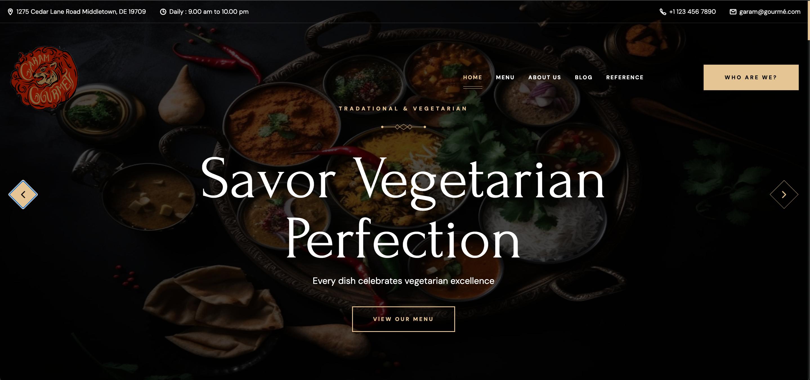
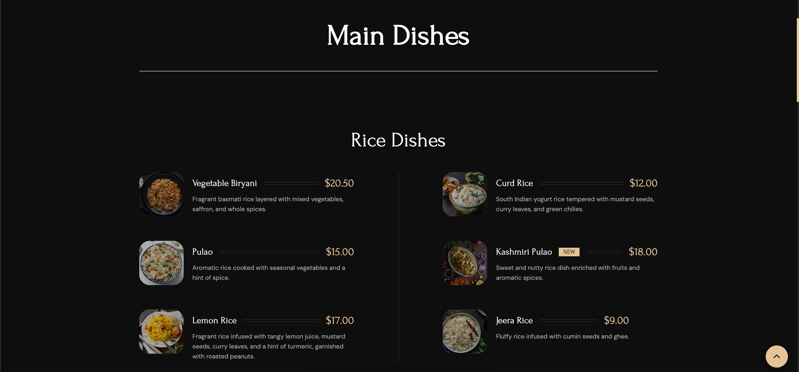
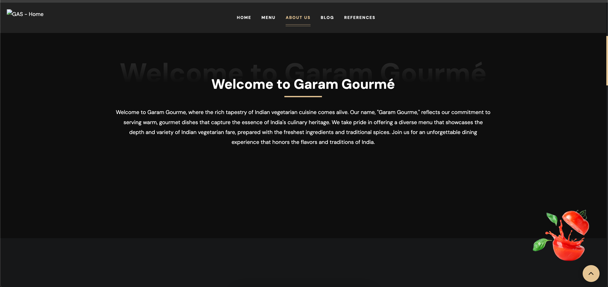
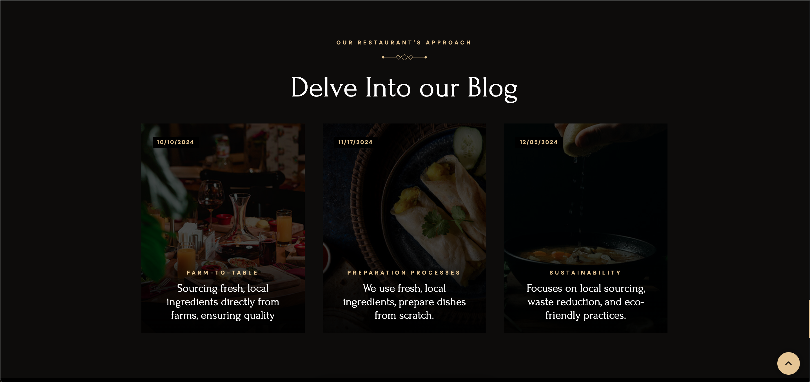
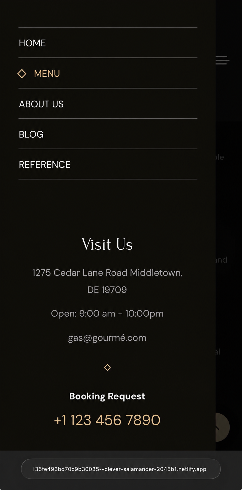
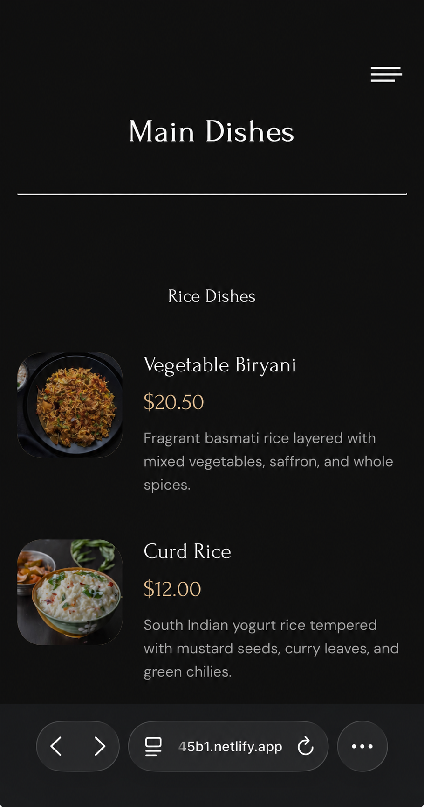

# Garam Gourmé — Vegetarian Restaurant Website

A responsive, multi-page website for a vegetarian restaurant concept. The project combines restaurant branding and content with a desktop/mobile interface for browsing the menu, learning about the restaurant, and reading food-related posts.

**[Open the Netlify preview](https://67a7f35fe493bd70c9b30035--clever-salamander-2045b1.netlify.app/)** · [Source code](https://github.com/SrinidhiKotteswaran/Vegetarian-restaurant-website)

> **Project note:** The repository's source identifies an existing CodeWithSadee restaurant template as a starting point. This project should be understood as a customized website/template adaptation, not as a claim that every component was designed from a blank file. Preserve any applicable original-template attribution when redistributing the source.

## Pages and features

- Homepage with restaurant branding and featured content
- Menu page for browsing vegetarian offerings
- About page with restaurant information
- Blog page with food-related content
- Responsive navigation for smaller screens
- Shared visual styling, imagery, and page-specific layouts
- JavaScript-driven interface interactions

## Screenshots

### Homepage

### Menu and about pages
<table>
  <tr>
    <td width="50%" align="center"><strong>Menu</strong>  </td>
    <td width="50%" align="center"><strong>About</strong>  </td>
  </tr>
</table>

### Blog

### Mobile layout
<table>
  <tr>
    <td width="50%" align="center"><strong>Mobile navigation</strong>  </td>
    <td width="50%" align="center"><strong>Mobile menu</strong>  </td>
  </tr>
</table>

## Technology

- HTML5
- CSS3
- JavaScript
- Netlify deployment

The site is built as a collection of linked HTML pages with CSS styling and JavaScript interactions rather than a React application.

## Run locally

No build step is required. Clone or download the repository and open `index.html` in a browser. For more reliable local testing of relative paths and page navigation, serve the folder with a simple local HTTP server.

## Development focus

The work centers on adapting the template into a coherent restaurant concept, organizing multiple pages and shared assets, and refining the interface for smaller screens. The screenshots document the page layouts currently stored in the repository.

## Scope and limitations

Garam Gourmé is a fictional restaurant concept, not an operating business. The site has no live reservation backend, customer-service line, or operational restaurant contact details. Contact-style elements are illustrative only.

The source is adapted from an existing CodeWithSadee restaurant template. Keep appropriate upstream attribution and review the original template's license before redistributing or reusing its assets.

## Developer

[Srinidhi Kotteswaran](https://github.com/SrinidhiKotteswaran)
